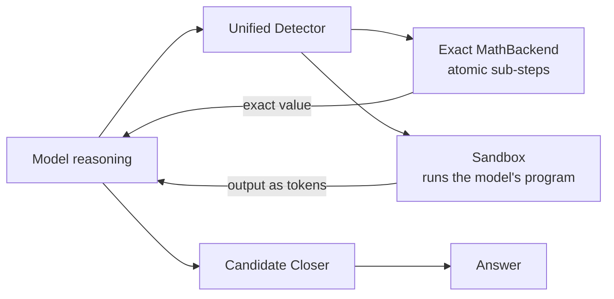

Hi My name is Tun Theerut
===================================================================================================================================

Software Engineer · Tech Lead & System Architect[ @T4 Labs](https://github.com/Slow-Inc) · AI Engineer + AI Researcher
-------------------------------------------------------

Full-stack, Backend & ML Systems, Inference Engine, Local LLM · **Architecture scope**

> I'm building **MIP + Sandbox** on [Strata-xeno](https://github.com/xenodeve/Strata-xeno): an inference engine that does the math and runs the experiments *inside* an LLM's reasoning, so the model only has to think.
> On models and domains it was never tuned on, it catches **94.4 %** of the arithmetic. Across **128,598** values it has written **0 false ones**. Tested on an **NVIDIA A100** at the full 262K context.

### Current research: MIP + Sandbox on Strata-xeno

[Strata-xeno](https://github.com/xenodeve/Strata-xeno) is my fork of [Strata](https://github.com/Niko1221/Strata) that runs Qwen3.8-Flash-Next (125B MoE) on a two-GPU gaming PC. On it I'm building **MIP (Model-Integrated Protocol)**: the engine computes and executes *inside* the model's reasoning, with no tool-call round trip. **Software takes every calculation it can; the model only analyses the question and forms hypotheses.**

- **Inline exact math:** each calculation is caught as it is written, every atomic sub-step is evaluated exactly, and the value goes straight back into the reasoning. The General Style writes only what is true under every reading; model profiles only pick among true forms.
- **Sandbox in the reasoning:** the model writes a small program, the engine runs it, and the output returns as tokens, so a hypothesis can be tested, fail and be revised mid-thought.
- **Candidate Closer:** the thinking ends only on software evidence, never on prose keywords.

| benchmark | result |
|---|---|
| Fresh held-out set H3: 1,526 traces from Qwen3-235B, Gemini and DeepSeek-R1, math and science | **94.4 %** of arithmetic caught, rules frozen before it was read |
| Truth gate over every stored trace | **0 false** in 128,598 inline values |
| **NVIDIA A100**, Qwen3.5-4B, full 262K context | DeepMind Mathematics and MATH-500 Level 5, against a control |
| Also run on | LiveBench (math, reasoning, code) and recent contest problems |

Issue trail: PRD [#276](https://github.com/xenodeve/Strata-xeno/issues/276) → target [#298](https://github.com/xenodeve/Strata-xeno/issues/298) → scrutiny [#301–#305](https://github.com/xenodeve/Strata-xeno/issues/301) → General Style [#307](https://github.com/xenodeve/Strata-xeno/issues/307) → H3 [#308](https://github.com/xenodeve/Strata-xeno/issues/308)

### MangaDock

I design and build reliable software systems across product, platform and ML boundaries. At [T4 Labs](https://github.com/Slow-Inc) I serve as Tech Lead and architecture owner for [MangaDock](https://github.com/Slow-Inc/MangaDock), a three-service manga translation platform built with Next.js, NestJS and a Python GPU inference server. My work covers service boundaries, translation pipelines, distributed state, security contracts, reliability and the engineering workflow that lets a small team build and hand off safely.

### Systems engineering focus

- **Resilient multi-tier state:** designed MangaDock's L1 in-process cache, shared L2 Redis cache and disk-backed L3 recovery layer as a write-behind system rather than a simple buffer
- **Failure recovery:** leader election, dirty queues, batch persistence, retry/dead-letter handling and recovery paths across Redis, local persistence and Supabase
- **Applied ML systems:** OCR, translation, inpainting and patch-based rendering pipelines for manga pages
- **Engineering enablement:** architecture documentation, simulations, tests and overlap-friendly team workflows
- **AI-assisted engineering:** use coding agents as adversarial reviewers to surface edge cases while retaining architectural ownership and final implementation decisions
- **Measurement discipline:** every mechanism is reported as *caught / should have caught*, rules are frozen before a fresh held-out set is read, and every disagreement is read by hand

* 🌍  I'm based in Bangkok, Thailand
* 🎓  B.Sc. Mathematics with Computer Science, KMUTNB (Year 4)
* 🖥️  See my portfolio at [My Profile Website](https://sites.google.com/email.kmutnb.ac.th/xeno/work)
* ✉️  You can contact me at [xenodev2004@gmail.com](mailto:xenodev2004@gmail.com)
* 🚀  I'm currently building [Strata-xeno](https://github.com/xenodeve/Strata-xeno) and [MangaDock](https://github.com/Slow-Inc/MangaDock)
* 🧠  I'm learning UX/UI

### Skills

### Socials

 <a href="https://discord.com/users/xeno.2004" target="_blank" rel="noreferrer"> <picture> <source media="(prefers-color-scheme: dark)" srcset="https://raw.githubusercontent.com/danielcranney/readme-generator/main/public/icons/socials/discord-dark.svg" /> <source media="(prefers-color-scheme: light)" srcset="https://raw.githubusercontent.com/danielcranney/readme-generator/main/public/icons/socials/discord.svg" />  </picture> </a> <a href="https://www.facebook.com/dgg.alpha" target="_blank" rel="noreferrer"> <picture> <source media="(prefers-color-scheme: dark)" srcset="https://raw.githubusercontent.com/danielcranney/readme-generator/main/public/icons/socials/facebook-dark.svg" /> <source media="(prefers-color-scheme: light)" srcset="https://raw.githubusercontent.com/danielcranney/readme-generator/main/public/icons/socials/facebook.svg" />  </picture> </a> <a href="https://www.github.com/xenodeve" target="_blank" rel="noreferrer"> <picture> <source media="(prefers-color-scheme: dark)" srcset="https://raw.githubusercontent.com/danielcranney/readme-generator/main/public/icons/socials/github-dark.svg" /> <source media="(prefers-color-scheme: light)" srcset="https://raw.githubusercontent.com/danielcranney/readme-generator/main/public/icons/socials/github.svg" />  </picture> </a> <a href="http://www.instagram.com/alpha.tun" target="_blank" rel="noreferrer"> <picture> <source media="(prefers-color-scheme: dark)" srcset="https://raw.githubusercontent.com/danielcranney/readme-generator/main/public/icons/socials/instagram-dark.svg" /> <source media="(prefers-color-scheme: light)" srcset="https://raw.githubusercontent.com/danielcranney/readme-generator/main/public/icons/socials/instagram.svg" />  </picture> </a> <a href="https://www.linkedin.com/in/xeno-undefined-b2441a2a7/" target="_blank" rel="noreferrer"> <picture> <source media="(prefers-color-scheme: dark)" srcset="https://raw.githubusercontent.com/danielcranney/readme-generator/main/public/icons/socials/linkedin-dark.svg" /> <source media="(prefers-color-scheme: light)" srcset="https://raw.githubusercontent.com/danielcranney/readme-generator/main/public/icons/socials/linkedin.svg" />  </picture> </a> <a href="https://www.youtube.com/@xeno.2004" target="_blank" rel="noreferrer"> <picture> <source media="(prefers-color-scheme: dark)" srcset="https://raw.githubusercontent.com/danielcranney/readme-generator/main/public/icons/socials/youtube-dark.svg" /> <source media="(prefers-color-scheme: light)" srcset="https://raw.githubusercontent.com/danielcranney/readme-generator/main/public/icons/socials/youtube.svg" />  </picture> </a> <a href="https://www.twitch.tv/momoexia__" target="_blank" rel="noreferrer"> <picture> <source media="(prefers-color-scheme: dark)" srcset="https://raw.githubusercontent.com/danielcranney/readme-generator/main/public/icons/socials/twitch-dark.svg" /> <source media="(prefers-color-scheme: light)" srcset="https://raw.githubusercontent.com/danielcranney/readme-generator/main/public/icons/socials/twitch.svg" />  </picture> </a>

### Badges

