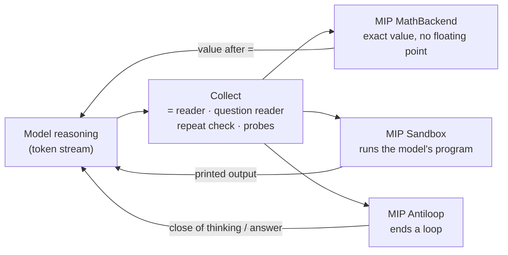
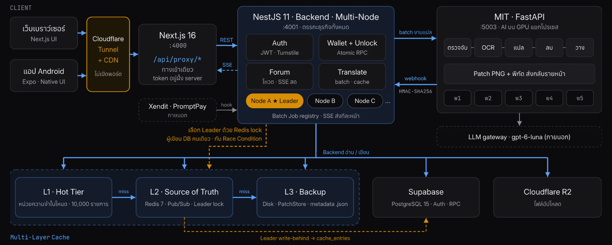

Hi My name is Tun Theerut
===================================================================================================================================

Software Engineer · Tech Lead & System Architect [@T4 Labs](https://github.com/Slow-Inc) · AI Engineer + AI Researcher · Self Learning
-------------------------------------------------------

Full-stack, Backend & ML Systems, Inference Engine, Local LLM · **Architecture scope**

> I'm building **MIP (Model Integrated Protocol) + Sandbox**: software that sits *inside* the inference engine, does the math and runs the experiments while an LLM is still reasoning, so the model only has to think. **No training, no weight changes, no second model.**
> On a 4B model it turns **161 → 218** right answers out of 240 on a fresh frozen set, gets **156 / 160** arithmetic answers right instead of 118 with **95 % fewer tokens**, and has put **0 wrong values** in **80,000+** checked insertions.

### Current research: MIP + Sandbox ([mip-research](https://github.com/xenodeve/mip-research))

**The idea.** A language model is a good reasoner and a bad calculator. When it multiplies two 5-digit numbers in its head it burns hundreds of tokens and still slips a digit, and a small model can get stuck repeating itself until the context runs out. MIP splits the work: **software takes every calculation it can, and the model only analyses the question and forms hypotheses.** The name echoes MCP on purpose, because the two put software beside a model from opposite sides:

| | MCP (Model Context Protocol) | MIP (Model Integrated Protocol) |
|---|---|---|
| Where the software sits | outside the engine, behind a tool server | inside the inference engine, beside the decode loop |
| Who starts it | the model, by writing a tool call | the engine; the model calls nothing |
| How a result arrives | a tool result after a round trip, then the model goes on | written straight into the token stream while the model writes |

**How it works.** The engine hands MIP each token as it is written. MIP reads what the model is doing, the connected software acts, and the result goes back into the stream mid-thought:

- **Inline exact math:** the moment the model writes `=`, MIP reads the expression, computes it exactly (387 operations, rational arithmetic) and writes the value in. It writes only what is true under every reading of the `=`; if anything is unsure, it writes nothing and the model goes on.
- **Sandbox in the reasoning:** the model writes a short program as part of its thinking (or the engine opens the block for it), MIP runs it in an isolation box and puts the printed output back, so a hypothesis can be tested, fail and be revised mid-thought, with no tool call and no turn round trip.
- **Antiloop:** small models fall into loops that never finish. MIP sees the repeat and closes the thinking or the answer, so the model writes an answer instead of running to the end of the context.
- **Engine-agnostic by design:** the goal is one module that any engine plugs in (llama.cpp, vLLM, [Strata-xeno](https://github.com/xenodeve/Strata-xeno)). Because it works on the token stream, the same module serves every model with no retraining.

**What it buys, measured against the same model without MIP:**

| Test | Without MIP | With MIP |
|---|---|---|
| **Fresh frozen set**, Qwen3.5-4B (NVFP4), 240 paired answers (DeepMind + MATH-500 L5), thinking on, full 262K context | 161 right | **218 right** (+57, sign test p = 1e-13; API reader 216; 3 are a correct decimal of an exact answer, counted right with a form note) |
| **Arithmetic**, Qwen3.5-4B, DeepMind 160 | 118 / 160 · 261,731 tokens | **156 / 160 · 12,062 tokens (−95 %)** · 85 % faster |
| **Loop-prone questions**, Qwen3.5-4B, A100 | 24 / 48 right · 21 with no answer | **37 / 48 right · 1 with no answer** |
| **Sandbox**, Qwen3.8-Flash-Next (125B MoE), 49 GSM8K + MATH questions × 2 | 73 right · 247,162 tokens | **77 right · 125,608 tokens (−49 %)** |
| **LiveCodeBench hard**, Qwen3.8-Flash-Next, 20 paired | 17 right · 684K tokens | **18 right · 272K tokens (−60 %)** |
| **5-digit multiplication** inside Strata's decode loop, Qwen3.8-Flash-Next | 491 tokens · 6.25 s | **137 tokens (−72 %) · 2.80 s (−56 %)** |
| **GSM-Hard 200**, Qwen3.8-Flash-Next | 731 tokens per answer | **571 (−22 %)**, same accuracy (177 vs 178) |
| **Hard reasoning** (GPQA, SuperGPQA, long MATH), tool route on an A100 | 1.00x tokens | **0.71x–0.81x**, within 1 answer per set |

| Safety check | Result |
|---|---|
| Every value MIP wrote, re-checked exactly | **0 wrong** in 41,176 frozen + 39,046 live insertions |
| Held-out H3: 1,526 traces from Qwen3-235B, Gemini and DeepSeek-R1, rules frozen before it was read | **94.4 %** of the arithmetic caught |
| Loop closers replayed on stored right answers | **0 of 1,078** right answers touched |

Every result names its model, build and machine, is paired against a control from the same round, and is scored by a rule and a second API reader with every disagreement read by hand. Built on the RTX 5060 Ti + RTX 4070 SUPER, tested on an NVIDIA A100. Still research: the methods change from round to round, and the next step is a frozen round on the A100.

Catalog of every mechanism and benchmark: [mip-research](https://github.com/xenodeve/mip-research) · [docs/INDEX](https://github.com/xenodeve/mip-research/blob/main/docs/INDEX.md) · tracker [#19](https://github.com/xenodeve/mip-research/issues/19)

### MangaDock: AI manga translation platform

[MangaDock](https://github.com/Slow-Inc/MangaDock) is my **Senior Project** at KMUTNB. It lets people read manga that has no Thai edition. It translates the text inside each page with AI and sets the Thai back into the speech bubbles, alongside a community forum, a creator studio, a coin wallet and an Android app. At [T4 Labs](https://github.com/Slow-Inc) I'm Tech Lead and architecture owner across its three services: Next.js, NestJS and a Python GPU inference server. **Live at [hayateotsu.space](https://hayateotsu.space).**

**Detect** (DBNet, YOLOv8-seg) → **OCR** (vision-LLM fallback) → **Translate** (LLM, one request per page, glossary for names) → **Inpaint** (LaMa; FLUX only on complex backgrounds) → **Render** (Thai word-aware line breaks) → only the changed patches are sent to the reader

| what | measured |
|---|---|
| Translation server, multi-GPU | 22 s → **4.36 s per page** (5 workers, −80 %) |
| A whole episode, translated async | first page readable at **~14 s** instead of ~43 s for 14 pages |
| Where a page's time goes | **83 %** is the LLM call; GPU work is only ~17 % |
| Thai layout match | **40–50 % → 90–95 %** with word-aware line breaking |
| Cache leader crash | stuck queue **38 s → 17 s** |
| Tests passing | 1,014 backend · 235 mobile · 169 cache |

Measured on an RTX 4070 SUPER 12 GB + RTX 5060 Ti 16 GB.

### Systems engineering focus

- **Resilient multi-tier state:** designed MangaDock's L1 in-process cache, shared L2 Redis cache and disk-backed L3 recovery layer as a write-behind system rather than a simple buffer
- **Failure recovery:** leader election, dirty queues, batch persistence, retry/dead-letter handling and recovery paths across Redis, local persistence and Supabase
- **Atomic payments:** coin unlocks run in one SQL function, so a double click charges once; top-ups are HMAC-checked and idempotent
- **Engineering enablement:** a docs portal of 369 documents, 42 ADRs and 25 interactive system simulations, so a small team can build and hand off safely
- **AI-assisted engineering:** use coding agents as adversarial reviewers to surface edge cases while retaining architectural ownership and final implementation decisions
- **Measurement discipline:** every mechanism is reported as *caught / should have caught*, rules are frozen before a fresh held-out set is read, and every disagreement is read by hand

* 🌍  I'm based in Bangkok, Thailand
* 🎓  B.Sc. Mathematics with Computer Science, KMUTNB (Year 4)
* 🖥️  See my portfolio at [My Profile Website](https://sites.google.com/email.kmutnb.ac.th/xeno/work)
* ✉️  You can contact me at [xenodev2004@gmail.com](mailto:xenodev2004@gmail.com)
* 🚀  I'm currently building [Strata-xeno](https://github.com/xenodeve/Strata-xeno) and [MangaDock](https://github.com/Slow-Inc/MangaDock) (my Senior Project)
* 🧠  I'm learning UX/UI

### Skills

### Socials

 <a href="https://discord.com/users/xeno.2004" target="_blank" rel="noreferrer"> <picture> <source media="(prefers-color-scheme: dark)" srcset="https://raw.githubusercontent.com/danielcranney/readme-generator/main/public/icons/socials/discord-dark.svg" /> <source media="(prefers-color-scheme: light)" srcset="https://raw.githubusercontent.com/danielcranney/readme-generator/main/public/icons/socials/discord.svg" />  </picture> </a> <a href="https://www.facebook.com/dgg.alpha" target="_blank" rel="noreferrer"> <picture> <source media="(prefers-color-scheme: dark)" srcset="https://raw.githubusercontent.com/danielcranney/readme-generator/main/public/icons/socials/facebook-dark.svg" /> <source media="(prefers-color-scheme: light)" srcset="https://raw.githubusercontent.com/danielcranney/readme-generator/main/public/icons/socials/facebook.svg" />  </picture> </a> <a href="https://www.github.com/xenodeve" target="_blank" rel="noreferrer"> <picture> <source media="(prefers-color-scheme: dark)" srcset="https://raw.githubusercontent.com/danielcranney/readme-generator/main/public/icons/socials/github-dark.svg" /> <source media="(prefers-color-scheme: light)" srcset="https://raw.githubusercontent.com/danielcranney/readme-generator/main/public/icons/socials/github.svg" />  </picture> </a> <a href="http://www.instagram.com/alpha.tun" target="_blank" rel="noreferrer"> <picture> <source media="(prefers-color-scheme: dark)" srcset="https://raw.githubusercontent.com/danielcranney/readme-generator/main/public/icons/socials/instagram-dark.svg" /> <source media="(prefers-color-scheme: light)" srcset="https://raw.githubusercontent.com/danielcranney/readme-generator/main/public/icons/socials/instagram.svg" />  </picture> </a> <a href="https://www.linkedin.com/in/xeno-undefined-b2441a2a7/" target="_blank" rel="noreferrer"> <picture> <source media="(prefers-color-scheme: dark)" srcset="https://raw.githubusercontent.com/danielcranney/readme-generator/main/public/icons/socials/linkedin-dark.svg" /> <source media="(prefers-color-scheme: light)" srcset="https://raw.githubusercontent.com/danielcranney/readme-generator/main/public/icons/socials/linkedin.svg" />  </picture> </a> <a href="https://www.youtube.com/@xeno.2004" target="_blank" rel="noreferrer"> <picture> <source media="(prefers-color-scheme: dark)" srcset="https://raw.githubusercontent.com/danielcranney/readme-generator/main/public/icons/socials/youtube-dark.svg" /> <source media="(prefers-color-scheme: light)" srcset="https://raw.githubusercontent.com/danielcranney/readme-generator/main/public/icons/socials/youtube.svg" />  </picture> </a> <a href="https://www.twitch.tv/momoexia__" target="_blank" rel="noreferrer"> <picture> <source media="(prefers-color-scheme: dark)" srcset="https://raw.githubusercontent.com/danielcranney/readme-generator/main/public/icons/socials/twitch-dark.svg" /> <source media="(prefers-color-scheme: light)" srcset="https://raw.githubusercontent.com/danielcranney/readme-generator/main/public/icons/socials/twitch.svg" />  </picture> </a>

### Badges

