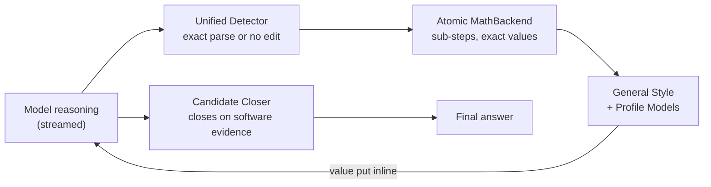

Hi My name is Tun Theerut
===================================================================================================================================

Software Engineer · Tech Lead · System Architect · AI Engineer + AI Researcher
-------------------------------------------------------

Full-stack, Backend & ML Systems, Inference Engine, Local LLM · **Architecture scope**

### Current research: MIP on Strata-xeno

[Strata-xeno](https://github.com/xenodeve/Strata-xeno) is my fork of [Niko1221's Strata](https://github.com/Niko1221/Strata). It runs Qwen3.8-Flash-Next (125B MoE) on a two-GPU gaming PC and is tuned for the lowest latency in a real coding-agent turn. On top of the engine I'm building **MIP (Model-Integrated Protocol)**: typed capabilities the model uses inside the engine, without decoding tool-call text, together with IGC (computation read from activations or from the tokens the model writes). The PRD and its gates live in [#276](https://github.com/xenodeve/Strata-xeno/issues/276). The current work follows one rule: **software takes every calculation it can, and the model only analyses the question and forms hypotheses.**

- **Unified Detector** reads the reasoning as it streams and decides where an exact value can be put in. A text edit needs an exact parse of what the text *means*, not just of its symbols: point names like `P(2, 3)` are not falling factorials, and patterns fitted to one benchmark question are removed ([#302](https://github.com/xenodeve/Strata-xeno/issues/302)).
- **Candidate Closer** ends the thinking only when a final answer is confirmed by software evidence (an executed program, a backend check), never by prose keywords ([#303](https://github.com/xenodeve/Strata-xeno/issues/303)). A repeated expression is not a loop ([#301](https://github.com/xenodeve/Strata-xeno/issues/301), [#304](https://github.com/xenodeve/Strata-xeno/issues/304)).
- **Atomic MathBackend sub-steps:** each step is evaluated by an exact math backend (numbers, counting, algebra, geometry, graph search, surd arithmetic) that is tested by simulation against SymPy, NetworkX, mpmath and brute force. Its scrutiny fixed or refused every wrong value found and removed contest-formula ops that were not general primitives ([#305](https://github.com/xenodeve/Strata-xeno/issues/305)).
- **General Style + Profile Models:** the default `general` style writes only what is true under every reading (`16807 ≡ 7`, `6 rem 1`, `144.6666...`). Guesses about notation (residue or full value, whole quotient, rounded decimal) live in per-model profiles (`qwen3.5-4b`, `deepseek-r1`, `qwq-32b`), each recording the sets it was measured on ([#307](https://github.com/xenodeve/Strata-xeno/issues/307)).

**How the issues connect**

| step | issue | what it settled |
|---|---|---|
| PRD | [#276](https://github.com/xenodeve/Strata-xeno/issues/276) | MIP by Qwenputer & IGC: the contract, the three paths (latent, token bridge, inline execution) and gates G1–G12 |
| target | [#298](https://github.com/xenodeve/Strata-xeno/issues/298) | MIP + sandbox as one engine module, aimed at Qwen3.6-35B-A3B on Strata-xeno |
| scrutiny | [#301](https://github.com/xenodeve/Strata-xeno/issues/301)–[#305](https://github.com/xenodeve/Strata-xeno/issues/305) | detector, closer and backend reviewed for destructive edits and false closes |
| hand check | [#306](https://github.com/xenodeve/Strata-xeno/issues/306) | 6 of 6 replayed corrections were false, so the check gets the detector's guards |
| generality | [#307](https://github.com/xenodeve/Strata-xeno/issues/307) | the held-out sets had been read, so: General Style, model profiles, and a frozen fresh set H3 |
| H3 result | [#308](https://github.com/xenodeve/Strata-xeno/issues/308) | General Style's truth gate: **0 false values of 41,176** on H3; the hand check's misreads are fixed from each notation's meaning |

### MangaDock

I design and build reliable software systems across product, platform and ML boundaries. I serve as Tech Lead and architecture owner for [MangaDock](https://github.com/Slow-Inc/MangaDock), a three-service manga translation platform built with Next.js, NestJS and a Python GPU inference server. My work covers service boundaries, translation pipelines, distributed state, security contracts, reliability and the engineering workflow that lets a small team build and hand off safely.

### Systems engineering focus

- **Resilient multi-tier state:** designed MangaDock's L1 in-process cache, shared L2 Redis cache and disk-backed L3 recovery layer as a write-behind system rather than a simple buffer
- **Failure recovery:** leader election, dirty queues, batch persistence, retry/dead-letter handling and recovery paths across Redis, local persistence and Supabase
- **Applied ML systems:** OCR, translation, inpainting and patch-based rendering pipelines for manga pages
- **Engineering enablement:** architecture documentation, simulations, tests and overlap-friendly team workflows
- **AI-assisted engineering:** use coding agents as adversarial reviewers to surface edge cases while retaining architectural ownership and final implementation decisions
- **Measurement discipline:** every mechanism is reported as *caught / should have caught*, rules are frozen before a fresh held-out set is read, and every disagreement is read by hand

* 🌍  I'm based in Bangkok, Thailand
* 🎓  B.Sc. Mathematics with Computer Science, KMUTNB (Year 4)
* 🖥️  See my portfolio at [My Profile Website](https://sites.google.com/email.kmutnb.ac.th/xeno/work)
* ✉️  You can contact me at [xenodev2004@gmail.com](mailto:xenodev2004@gmail.com)
* 🚀  I'm currently building [Strata-xeno](https://github.com/xenodeve/Strata-xeno) and [MangaDock](https://github.com/Slow-Inc/MangaDock)
* 🧠  I'm learning UX/UI

### Skills

### Socials

 <a href="https://discord.com/users/xeno.2004" target="_blank" rel="noreferrer"> <picture> <source media="(prefers-color-scheme: dark)" srcset="https://raw.githubusercontent.com/danielcranney/readme-generator/main/public/icons/socials/discord-dark.svg" /> <source media="(prefers-color-scheme: light)" srcset="https://raw.githubusercontent.com/danielcranney/readme-generator/main/public/icons/socials/discord.svg" />  </picture> </a> <a href="https://www.facebook.com/dgg.alpha" target="_blank" rel="noreferrer"> <picture> <source media="(prefers-color-scheme: dark)" srcset="https://raw.githubusercontent.com/danielcranney/readme-generator/main/public/icons/socials/facebook-dark.svg" /> <source media="(prefers-color-scheme: light)" srcset="https://raw.githubusercontent.com/danielcranney/readme-generator/main/public/icons/socials/facebook.svg" />  </picture> </a> <a href="https://www.github.com/xenodeve" target="_blank" rel="noreferrer"> <picture> <source media="(prefers-color-scheme: dark)" srcset="https://raw.githubusercontent.com/danielcranney/readme-generator/main/public/icons/socials/github-dark.svg" /> <source media="(prefers-color-scheme: light)" srcset="https://raw.githubusercontent.com/danielcranney/readme-generator/main/public/icons/socials/github.svg" />  </picture> </a> <a href="http://www.instagram.com/alpha.tun" target="_blank" rel="noreferrer"> <picture> <source media="(prefers-color-scheme: dark)" srcset="https://raw.githubusercontent.com/danielcranney/readme-generator/main/public/icons/socials/instagram-dark.svg" /> <source media="(prefers-color-scheme: light)" srcset="https://raw.githubusercontent.com/danielcranney/readme-generator/main/public/icons/socials/instagram.svg" />  </picture> </a> <a href="https://www.linkedin.com/in/xeno-undefined-b2441a2a7/" target="_blank" rel="noreferrer"> <picture> <source media="(prefers-color-scheme: dark)" srcset="https://raw.githubusercontent.com/danielcranney/readme-generator/main/public/icons/socials/linkedin-dark.svg" /> <source media="(prefers-color-scheme: light)" srcset="https://raw.githubusercontent.com/danielcranney/readme-generator/main/public/icons/socials/linkedin.svg" />  </picture> </a> <a href="https://www.youtube.com/@xeno.2004" target="_blank" rel="noreferrer"> <picture> <source media="(prefers-color-scheme: dark)" srcset="https://raw.githubusercontent.com/danielcranney/readme-generator/main/public/icons/socials/youtube-dark.svg" /> <source media="(prefers-color-scheme: light)" srcset="https://raw.githubusercontent.com/danielcranney/readme-generator/main/public/icons/socials/youtube.svg" />  </picture> </a> <a href="https://www.twitch.tv/momoexia__" target="_blank" rel="noreferrer"> <picture> <source media="(prefers-color-scheme: dark)" srcset="https://raw.githubusercontent.com/danielcranney/readme-generator/main/public/icons/socials/twitch-dark.svg" /> <source media="(prefers-color-scheme: light)" srcset="https://raw.githubusercontent.com/danielcranney/readme-generator/main/public/icons/socials/twitch.svg" />  </picture> </a>

### Badges

